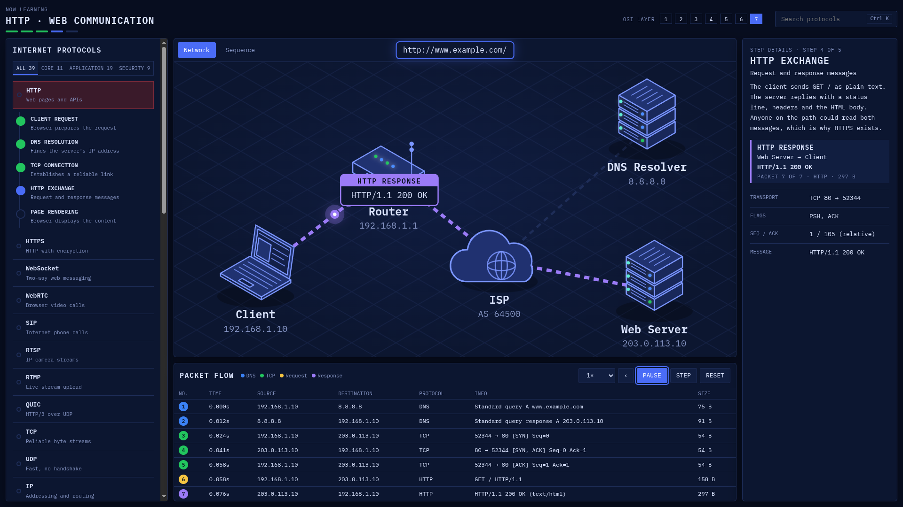

# 🌐 NetworkVisuals

  <strong>See how the internet works — one protocol, one packet, one step at a time.</strong>
   
  An interactive visual guide to the protocols that move data across networks.

  
  

  
  
  
  

## 🧭 What is NetworkVisuals?

Networking is easier to understand when you can **see the conversation**.

NetworkVisuals is a browser-based interactive networking visualizer that helps you understand how devices communicate. Explore network protocols, follow message sequences, and watch packet exchanges unfold between network devices.

From DNS lookups and TCP handshakes to HTTP requests, encrypted connections, VPN tunnels, wireless networking, and industrial protocols — NetworkVisuals makes the flow of network communication easier to follow.

## ✨ What you can explore

- **39 network protocols** across core networking, application communication, and security.
- **Step-by-step sequences** that show how a communication exchange happens.
- **Packet-flow visualisation** with source, destination, protocol, timing, information, and packet size.
- **Replay and step controls** to move through an exchange at your own pace.
- **OSI layer reference** to connect protocol behaviour with the networking model.
- **Protocol search and navigation** to find topics quickly.
- **Practical learning scenarios** that connect individual protocols into a complete communication flow.

## 🗂️ Protocol library

| Category | Topics | Examples |
| --- | ---: | --- |
| Core networking | 11 | TCP, UDP, IP, IPv6, DNS, DHCP, ICMP, Ethernet, BGP |
| Application protocols | 19 | HTTP, HTTPS, WebSocket, SMTP, IMAP, FTP, SSH, SMB |
| Security protocols | 9 | TLS/SSL, DNSSEC, WPA3, RADIUS, WireGuard, IPsec |

The library also introduces technologies used in web communication, routing, wireless networks, remote access, proxies, streaming, and industrial control.

## 🔬 Example: what happens when you open a website?

Choose **HTTP** and follow a simplified web request from start to finish:

1. **DNS resolution** — the client looks up the server's IP address.
2. **TCP connection** — the client and server establish a reliable connection.
3. **HTTP request** — the browser sends a request, such as `GET /`.
4. **HTTP response** — the server replies, for example with `HTTP/1.1 200 OK`.
5. **Page rendering** — the browser uses the returned content to display the page.

The packet-flow view shows the endpoints, protocol, order, timing, and size of each illustrative packet.

> **Learning note:** The HTTP example demonstrates unencrypted HTTP traffic. HTTPS uses TLS to protect application data in transit. The displayed addresses and packet details are illustrative, not a live capture.

## 🎯 Who is it for?

- Students learning computer networks and the OSI model.
- IT support and networking beginners building practical fundamentals.
- Cybersecurity learners exploring how normal network traffic works.
- Anyone looking for a visual introduction to internet and network protocols.

## 🚀 Try it

**[Launch NetworkVisuals](https://mohd-ali2.github.io/NetworkVisuals/)**

No account or specialised networking software is required. Open the site and start exploring.

## ⭐ Support the project

If NetworkVisuals helped you understand a networking concept, or you simply find it useful, please consider **giving the repository a star**. It helps more students, networking beginners, and cybersecurity learners discover the project.

[⭐ Star NetworkVisuals on GitHub](https://github.com/Mohd-Ali2/NetworkVisuals)

## 📄 License

NetworkVisuals is licensed under the [MIT License](LICENSE). You are free to use, modify, and distribute the project, provided the copyright and license notice are included.

## 🤝 Feedback and contributions

Found a bug, spotted an incorrect explanation, or have an idea for another protocol or visualisation?

- [Report a bug](https://github.com/Mohd-Ali2/NetworkVisuals/issues)
- [Suggest a feature or protocol](https://github.com/Mohd-Ali2/NetworkVisuals/issues)
- [Browse the source code](https://github.com/Mohd-Ali2/NetworkVisuals)

Suggestions, corrections, and improvements are welcome.

## 🛠️ Built for learning

NetworkVisuals is designed as a lightweight, browser-based learning tool. Its goal is to make computer networking, protocol behaviour, and packet flow easier to visualise and understand.

---

  Made to make networking easier to see, understand, and remember.
   
  NetworkVisuals · Learn the flow behind the connection.

